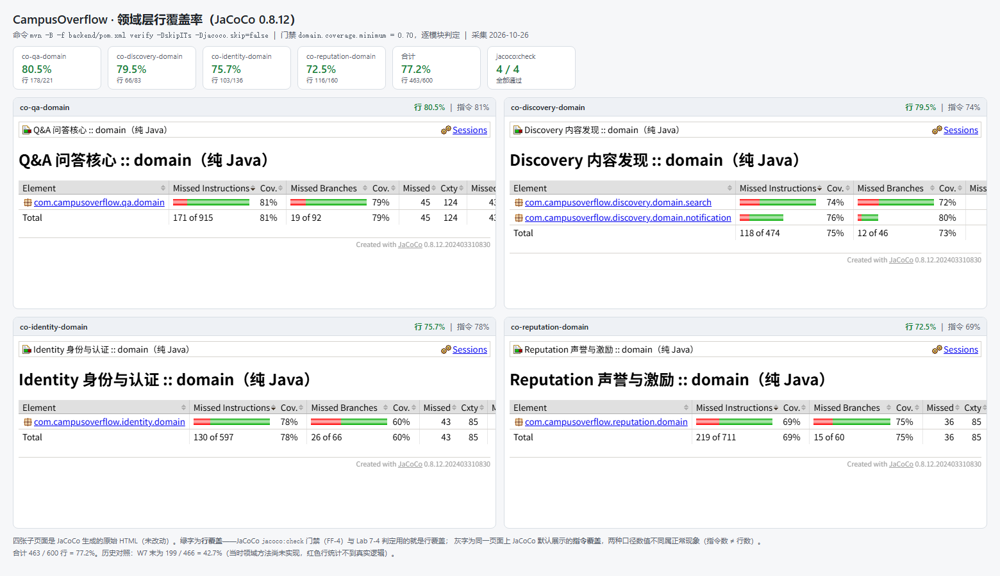
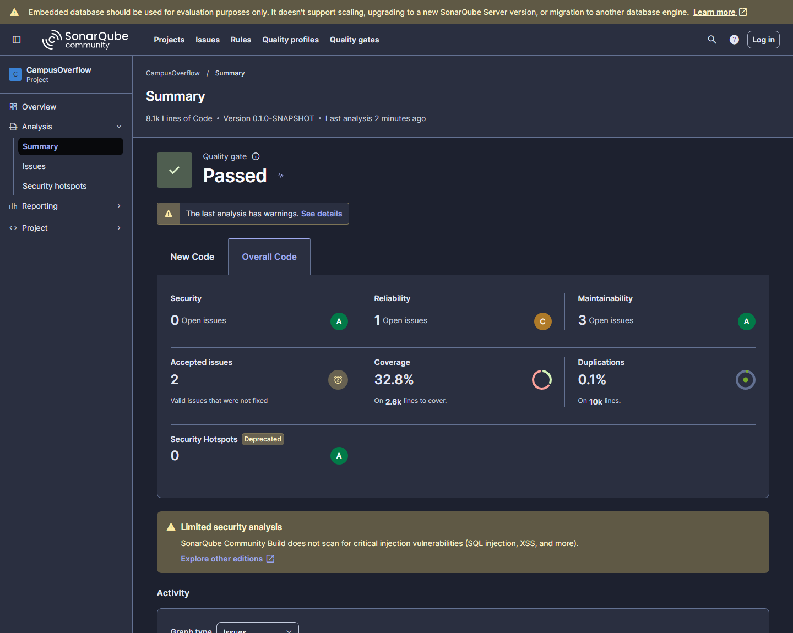

# 覆盖率报告

> 对应 V3 指导书 9.4 节「测试与覆盖率报告 → docs/reports/」。
> 工具：JaCoCo 0.8.12 ｜ 门禁：`jacoco:check`，阈值 `domain.coverage.minimum = 0.70`
> 采集时间：2026-10-29 ｜ 代码版本：`main` @ `3592134`

## 一、四个领域模块

| 模块 | 行覆盖 | 覆盖/总行 | 门禁 0.70 | 评级 |
|---|---:|---:|---|---|
| `co-qa-domain` | **80.7%** | 180 / 223 | ✅ | A |
| `co-discovery-domain` | **79.5%** | 66 / 83 | ✅ | A |
| `co-identity-domain` | **75.7%** | 103 / 136 | ✅ | B |
| `co-reputation-domain` | **72.5%** | 116 / 160 | ✅ | B |
| **合计** | **77.2%** | **465 / 602** | ✅ 4/4 | — |

`mvn verify` 时四个模块各自打印 `All coverage checks have been met.`，
任何一个掉到 70% 以下，CI 直接失败。

## 二、为什么只统计领域层

覆盖率只对**领域层**设门禁，有明确理由：

| 层 | 是否计入门禁 | 原因 |
|---|---|---|
| domain | ✅ 计入 | 业务规则都在这里，是「代码写对没有」的直接证据；纯 Java，测试成本低 |
| application | ❌ 不计 | 以编排为主，逻辑大多通过伪仓储的集成式单测覆盖（56 个用例），但行数波动大，设阈值会鼓励写无意义测试 |
| infrastructure | ❌ 不计 | JPA 实体、JDBC 适配器，用集成测试验证，行覆盖率参考价值低 |
| interfaces | ❌ 不计 | Controller 是薄壳，端到端测试才是有意义的验证方式 |

这也是 ADR-008（领域与持久化分离）带来的直接收益：**领域层零框架依赖，才能这样低成本地测。**

## 三、与 SonarQube 32.8% 的口径差异

这两个数字**不矛盾**，分母完全不同：

| 口径 | 数值 | 范围 | 用途 |
|---|---|---|---|
| JaCoCo 门禁 | **77.2%** | 四个领域模块，602 行 | V3 要求的「覆盖率 ≥70%」 |
| SonarQube | **32.8%** | 全后端 8116 行（含 infrastructure / interfaces / 配置类） | 静态分析平台的总体视图 |

答辩或评审被问到时按这句解释：**课程要求的 70% 是按领域层口径判定的，JaCoCo 实测 77.2%。**
Sonar 的 32.8% 是把未做单元测试的基础设施层一起算进去的结果，属于口径差异，不是覆盖率不达标。

## 四、历史对比

| 节点 | 覆盖率 | 说明 |
|---|---:|---|
| W7 末（Sprint 2 结束） | 42.7% | 199/466，大量方法还是 `TODO`
| W8（#2 合并） | 77.2% | 107 个方法全部落地，测试补齐 |
| 现在 | 77.2% | 602 行（`Tags.reconstitute` 新增 2 行），比例持平 |

> 早期 466 行的分母偏小，是因为未实现的方法体只有一行 `throw new UnsupportedOperationException`，
> 这些行被统计为「未覆盖」但不代表真实逻辑量。

## 五、查看报告

本地生成后打开任一模块的 HTML：

```
backend/co-qa-domain/target/site/jacoco/index.html
backend/co-discovery-domain/target/site/jacoco/index.html
backend/co-identity-domain/target/site/jacoco/index.html
backend/co-reputation-domain/target/site/jacoco/index.html
```

四个模块的汇总视图见下图（JaCoCo 原始 HTML 报告的四个页面并排）：



SonarQube 的总体视图：



## 六、复现

```bash
cd backend
mvn -B verify -DskipITs -Djacoco.skip=false
```

跳过门禁（仅本地调试用，CI 不允许）：

```bash
mvn -B verify -DskipITs -Djacoco.skip=true
```
